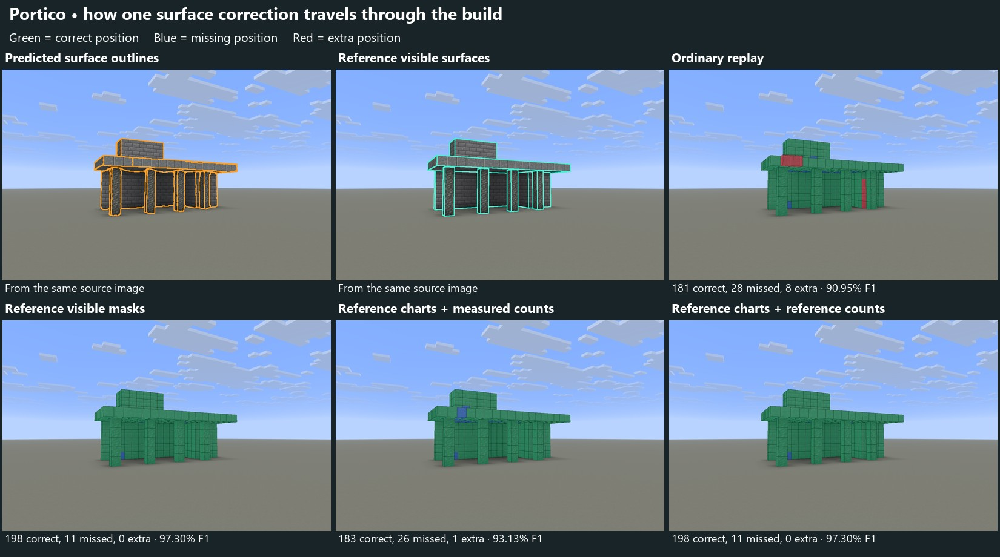

# Giving the counter and placer the visible reference surfaces

On 20 source images, replacing the finder's surface masks brought strict placement F1 from **89.95% to 95.19%**, and strict position-plus-material F1 from **86.42% to 91.79%**. This intervention supplied the correct grouping of visible pixels while carrying forward the most overlapping predicted surface's normal and relative depth wherever available. Seventeen views improved, two tied and one regressed. All seven arms produced and decoded a typed Minecraft pack on every view.

## Where the improvement travels

| Supplied evidence | Placement F1 | Facade placement F1 | Position + ID F1 | Facade position + ID F1 |
| --- | ---: | ---: | ---: | ---: |
| Original finder and estimated camera, paired replay | 89.95% | 92.20% | 86.42% | 89.32% |
| Visible reference masks | 95.19% | 97.11% | 91.79% | 94.38% |
| Masks and correct face directions | 95.88% | 97.30% | 92.50% | 94.61% |
| Masks, directions and correct sampling charts; ordinary counter | 95.49% | 97.06% | 92.07% | 94.40% |
| Masks, directions, charts and correct chart dimensions | 95.92% | 97.35% | 92.52% | 94.62% |
| Recorded camera with original finder | 90.87% | 92.55% | 87.30% | 89.87% |
| Recorded camera, masks, directions, charts and dimensions | **97.13%** | **98.03%** | **93.47%** | **95.34%** |

The reference masks recovered 205 previously missed correct positions and lost 26. They removed 228 extras and added 22. Adding correct directions then recovered 48 and lost four. Supplying the reference chart while retaining inferred counts gained one position and lost 24 compared with directions alone. Giving that chart its actual dimensions recovered 25 positions, lost zero, removed seven extras and added one. Even with all supplied evidence the placer must still infer depths and voxel ownership. The material matcher still has to identify each placed block from the source image. Results for this sample describe interventions and can interact across stages. They are unsuitable as independent additive shares of the full-suite gap. [Pooled and per-handoff counts](summary.json)

| Sample | Paired baseline, placement / position + ID | True masks, placement / position + ID | All supplied evidence, placement / position + ID |
| --- | ---: | ---: | ---: |
| 12 sampled fixed views | 90.78% / 85.23% | 93.90% / 88.63% | 96.24% / 90.63% |
| 8 sampled comparison views, including two training views | 88.77% / 88.11% | 97.07% / 96.40% | 98.43% / 97.63% |

## What the Block Counter could read

The denominator is 322 visible reference surfaces across the same 20 images. Pairing uses a unique prediction/reference match with native source-mask IoU of at least 0.5. Width and height are ordered whole-block spans of the visible face cells in the chart directions. A surface with holes can occupy fewer blocks than its bounding span. Unmatched reference surfaces and unresolved dimensions receive zero exact-span credit.

| Input | Paired surfaces | Both counts available on pair | Correct width | Correct height | Both visible spans exactly right |
| --- | ---: | ---: | ---: | ---: | ---: |
| Original finder | 234 | 84 | 67 | 72 | 52 |
| Reference visible masks | 322 | 171 | 146 | 156 | 132 |
| Plus reference directions | 322 | 171 | 147 | 156 | 134 |
| Plus reference charts; ordinary counter | 322 | 217 | 191 | 202 | 172 |

Two of the 322 supplied reference charts were subsequently revised by the ordinary counter's alternate crop pass. The true-count arm resets the actual metering quad and its two counts **after** counting and before the ordinary placer consumes `_charts`. At the correct quad, the ordinary counter is still missing at least one estimate on 105 surfaces. Another 45 return both estimates but miss at least one visible span. A barely visible fraction of an edge block can contribute one whole cell to the reference span. [Per-image count availability and exact spans](count-handoffs.json)



Portico masonry low-left illustrates why an improved stage metric can be insufficient. The mask treatment recovers 17 more correct positions and removes all eight extras. Reference charts with measured counts then lose 15 correct positions on this view and introduce one extra. Correcting the corresponding chart dimensions recovers that difference. The counter's number of surfaces with both correct spans on this image actually **increases** from 10 to 11 with reference charts. Which charts anchor which geometry matters more here than the sum of correctly counted surfaces.

## What the replay supplies

- Selection took the two smallest source SHA-256s from each of the 10 locked cohorts at code revision `5818a37`, independent of the outcomes. These are 20 distinct images, including multiple views from some families. The fixed cohort's full 104-view placement scores remain 91.27% strict and 93.42% facade-priority.
- Every reference mask uses only native first-hit pixels. Each mask groups connected visible cube faces on the same plane and direction, across materials. Ordinary source-image chart fitting runs on the new footprint. Each reference region inherits its greatest-overlap predicted region's relative depth and, in the mask-only arm, its predicted normal. A region without overlap gets neither inferred attribute. The directions arm supplies recorded face normals in camera coordinates. Ground-truth depths and materials are never passed to the placer in these interventions.
- The chart arm supplies the projected four corners of the bounding cell span of faces that have visible pixels. These may extend past an irregular mask. Each crop keeps the actual visible support and excludes holes. The grids and joint arms also supply both counts for that whole chart. The chart does not directly set a placement level. The camera arms use `P_capture_world × local_to_world`, placing the capture camera in the registered local coordinate system.
- Every arm calls the ordinary surface counter, ranked visible placer, applicable pavement/extent/corner/exterior checks and production material matcher. It serializes and decodes the typed pack, then scores the same visible targets and optional slivers after the best single whole-build integer translation. The replay operates at the public surface handoff. Production also retains scene-specific pre-inset and pre-exterior context for some late fixes. The paired baseline reproduced **18/20 published typed packs byte-for-byte**. On Facade oblique-right the strict geometry counts tied but the replay had two more correct IDs. On Offset Gate quartz high-right it placed 15 fewer extras. The tables compare each intervention against its own same-path control.
- This study supplies answers unavailable from a user's image. It establishes experimental headroom. It does not implement a deployable source-only improvement. We recommend improving mask coverage first, then testing the handoff from chart counts to depth choices before promoting an upstream change. [Per-source geometry, typed scores, hashes and changes](cases.json) · [Scored position and material maps](scored-sites.json.gz)

## Replay

Restore the fixed inputs used by the typed release and the geometry replays. From this checkout:

```powershell
python -m benchmark.reference_surface_feedback --per-split 2 --out runs/surface-feedback
python -m benchmark.reference_surface_summary --in runs/surface-feedback --per-split 2
python -m benchmark.reference_counter_handoffs --per-split 2
python -m benchmark.reference_surface_sheet --in runs/surface-feedback
```

