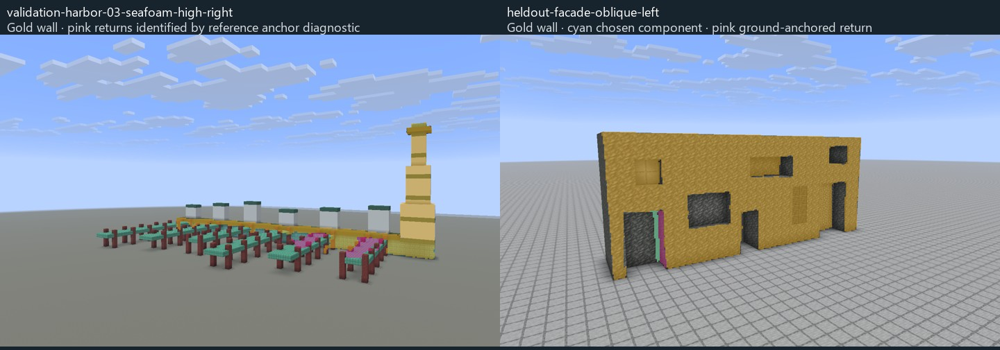

# Can a visible return locate the adjoining wall?

Keep `experiment/return-face-depth-proposals` experimental. On 13 saved Java 26.3 views the return-face rule changed one wall component before Block Counter, on the historical Facade. Its final export matched the ordinary release. Five additional exports tested the strongest supported move on frames where the rule abstained. Only Market Court improved, from 63.90% to 64.67% strict placement F1, through a net reduction of nine extras despite losing one net correct position.



## Placement

| Pilot cohort | Tested / available | Strict / facade placement | Strict / facade placement + ID | Correct / missed / extra |
| --- | ---: | ---: | ---: | ---: |
| Fixed historical | 2 / 104 | 87.02 / 92.52 | 85.46 / 90.70 | 446 / 101 / 32 |
| Visible Builds v3 | 9 / 144 | 51.91 / 55.26 | 31.21 / 34.04 | 5,356 / 7,343 / 2,581 |
| Decorative Builds v1 | 2 / 40 | 64.82 / 65.53 | 56.79 / 56.99 | 444 / 324 / 158 |
| Pilot pooled | 13 / 13 | 54.24 / 57.48 | 35.14 / 37.87 | 6,246 / 7,768 / 2,771 |

All four scores tied the paired release. All 13 cameras were usable. The full fixed-104 default at `e3bd220` remains 91.27 / 93.42 placement and 84.68 / 88.51 with IDs, with 20,773 correct, 2,929 missed and 1,046 extra. The full Visible Builds v3 default remains 46.63 / 48.04 and 28.04 / 29.08 with seven camera failures accounting for 26,122 strict misses. Decorative Builds v1 remains 63.46 / 65.23 and 50.51 / 52.56. These full-cohort results and the previous historical-112 series were not remeasured here.

## What was offered

For the largest visible wall carrier, connect color-consistent 4×4 source samples using the existing RGB partition. Consider perpendicular planes from the ordinary visible surfaces and, on the expanded cohorts, the raw full-frame relaxed planarity masks. Include horizontal planes and embedded returns. A vertical plane can be anchored at the ground silhouette. An atlas anchor requires two different visible tiles with the second scoring at least .55, a top-two mean of .68, and .08 separation from the next level. Search horizontal levels 1–24 and vertical levels across the observed ground-contact range with a three-block margin. The old target-level radius never limits these proposals.

At every direct four-neighbor contact, intersect the boundary ray with the return plane to predict the local integer plane of the adjoining wall. At least one ray within .35 block produces an inventory entry. The selector requires seven supporting boundary samples, at least 20 pixels of image extent, 72% agreement and a median discrepancy of at most .22 block on both halves. Rank eligible alternatives by support fraction, image extent and anchor strength, and offer at most one changed component per frame. These thresholds stayed fixed across the four development buildings, the five previously reviewed Harbor and Castle frames, the two fixed regression cases and the two decorative transfer cases. The existing source-only parent plane supplies the option to keep the ordinary build.

The 47 recorded boundary/level entries included repeated levels from independent masks and levels equal to the parent. Across retained RGB components the incumbent placed 668,693 of 1,101,891 same-axis native pixels at the right level. A scoring-only per-component chooser among the offered levels covered 731,227. Allowing the independently best native level in every component covered 978,131. This pixel opportunity is distinct from final exported block F1.

**Harbor 03 seafoam high-right.** All 19 candidate return masks lacked a ground or atlas anchor. With the photographed wall on Z50, 72 of the 37,191 same-axis native pixels inside retained RGB components had the correct level. Supplying the dominant native axis and level only for sufficiently pure returns let the two horizontal returns shown in pink offer eight component/level entries. Choosing the best of those entries reached 3,289 correct pixels. The unrestricted per-component maximum was 32,147. Neither return passed the contact selector. This diagnosis uses the reference only to measure the return-anchor handoff. The reconstructed pack carried the source-only result of 17.23% strict.

## Exported alternatives

The source-only replay split the selected component and its residual before counting, rebuilt their sampling charts and dimensions, supplied the new component plane during reconciliation and ran the ordinary remaining placement, materials and export stages. The historical Facade child passed using 37 seam samples and moved from local X−2 to X0. Recount and placement both observed the change, then the downstream export reproduced the same structure. The remaining 12 source-only runs retained the current surface layout. All 13 newly exported packs matched every released file after decompressing the NBT members. ZIP timestamps and gzip headers differed on the expanded replay, so the machine-readable report retains both raw pack hashes.

| Additional source-ranked move forced through the gate | Strict F1 before → after | Correct gained / lost | Extras added / removed |
| --- | ---: | ---: | ---: |
| Amphitheater ashlar high-right | 52.85 → 51.80 | 19 / 37 | 33 / 20 |
| Viaduct riverstone high-right | 82.73 → 55.02 | 16 / 306 | 348 / 65 |
| Castle 01 ashlar high-right | 75.43 → 63.13 | 28 / 204 | 184 / 32 |
| Market Court cool high-right | 63.90 → 64.67 | 9 / 10 | 9 / 18 |
| Walled Garden warm high-right | 65.49 → 56.69 | 14 / 59 | 81 / 72 |

A per-frame perfect chooser among just the 13 incumbent, 13 selected and five forced exports kept Market Court's forced pack and all other incumbents. Pooled strict / facade placement moved from 54.2399 / 57.4813 to 54.2548 / 57.4994. With IDs it moved from 35.1439 / 37.8714 to 35.1766 / 37.9089. Other inventoried levels were graded for pixel coverage only. The five forced results include the consequences of recounting the split and refitting its residual and neighbors.

Run the following modules in order with the repository's expanded-baseline Python environment. The control receipt identifies each saved RGB source, input field, camera and reference. All new outputs use the checkout-local `runs/returns` folder. The benchmark commits no production changes.

```powershell
python -m benchmark.return_face_round
python -m benchmark.return_face_anchor_oracle
python -m benchmark.return_face_exports --mode chosen
python -m benchmark.return_face_exports --mode forced
python -m benchmark.return_face_report
```

[Dataset and paired scores](summary.json) · [Full candidate inventories, native depth histograms, canonical member hashes, reference-only anchor replay and scored exports](cases.json.gz)
