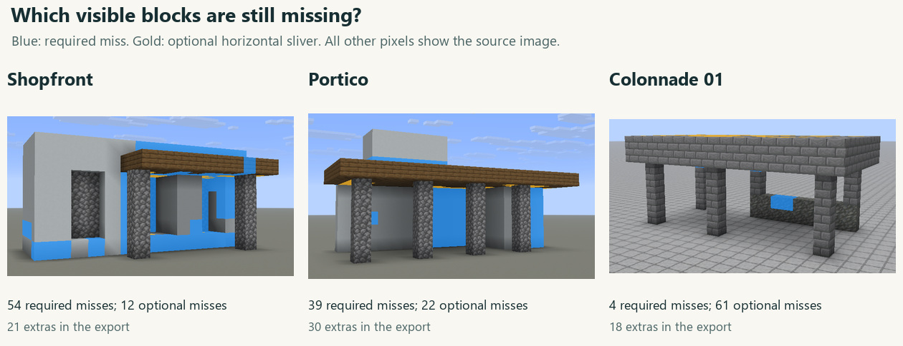

# Where visible block placement fails

The starting default at `abfc0be` places **20,619** blocks correctly, misses **3,083** visible positions and places **1,097** extras across 104 fixed whole-structure source images. Strict F1 is **90.80%**, and facade-priority F1 is **92.90%**. One integer translation of each entire build is allowed. The saved exports and scored visible coordinates were checked again for this round. All 104 have a supported camera. The best whole-build translation was zero on every fixed input, so camera-registered strict F1 also measured 90.80%. The 112-view historical score, which includes the eight retired frame-filling wall images, was 90.04%.

[Open the current interactive viewer](viewer.html) for the ranked structures, facade-priority error contributions, common failure patterns and 95% scenarios. The static [stage map](stage-map.jpg) and [five per-stage traces](stage-examples.json) below document the earlier shared-face experiment.



Blue marks the source pixels of missed blocks that count under facade-priority scoring. Gold marks missed horizontal-only blocks too thin to be required. Each color is drawn on that block's recorded visible pixels. The interactive viewer also shows every extra on a separate layer. On GitHub, download the checkout to open the HTML locally or use the static stage map.

## The highest-value problems

The 1,305 optional misses leave **1,778 required misses**, including **1,590 with at least one visible wall face**. Each required miss belongs to one row below. The classification compares what the exported blocks look like from the source camera. It identifies a failure symptom and the earliest evidence available for fixing it.

| What the exported build does at the missed position | Required misses | What to test |
| --- | ---: | --- |
| Leaves most of its source pixels uncovered | 866 | **298** already have a correctly oriented surface over most pixels but lack a complete count. Another **107** have the dimensions but lack a complete grid origin. Try alternate grid offsets on the same wall. The other **284** lack majority mask coverage and **177** have coverage without the right axis. Those need surface detection or orientation work first. |
| Covers it with the right face axis at a different coordinate | 552 | **507** are mostly covered by an extra block. Try moving a connected patch and projecting it back into the source image. For 404 of the 552, the dominant plane lies too close; for 132 it lies too far back. The remaining 16 lie on the right plane at the wrong position along it. |
| Covers it with a different face axis | 358 | Compare wall, top and underside interpretations against source texture direction and adjoining edges. In 216 cases the covering block is itself correct elsewhere, so blindly removing it would lose good geometry. |
| Ties on covered versus uncovered pixels | 2 | Insufficient majority for a classification. |

Of the 1,097 extras, 711 mostly project onto the structure, 385 mostly cover background and one has no first-hit pixels. Eliminating every extra while holding recall fixed would reach only **93.04% strict F1**. Keeping the current extra count would require **1,819 additional correct visible blocks for 95%**, or **2,736 for 97%**. [Native-pixel and per-layout audit](error-budget.json)

## Read the worst source images stage by stage

The five columns in the map are the five lowest individual fixed views after retaining one representative per distinct layout. They are ranked by strict F1. Each starts with the full source image, then follows a selected surface through its mask, source crop, straightened texture, block count, grid and optional material sampling. The last rows show the decoded build, visible reference and errors. Source-image outlines are orange; cyan selects the surface followed down the column. A blank material row records insufficient evidence for a complete tile. Placement can still recover geometry through other cues.

| Source image | Strict F1 | Required misses / optional misses / extras | Where the pipeline loses information |
| --- | ---: | ---: | --- |
| Open Canopy 00, right | 70.13% | 0 / 23 / 0 | All 23 misses are thin top-only positions. Twenty lie inside a detected mask without majority correct face direction. This view scores 100% for facade-priority placement. |
| Plaster Shopfront, low left | 70.31% | 54 / 12 / 21 | Only 2 of 15 detected surfaces have both dimensions. Of 38 required misses left mostly uncovered, 24 lie in correctly oriented masks without both counts. The source overlay shows the base and broad wall sections behind the posts. |
| Plaster Galleries, low left | 75.05% | 25 / 61 / 39 | Surface Finder matches 20 of 30 visible surfaces. Of 86 strict misses, 61 are optional. The 25 required misses span uncovered area (10), wrong axis (8) and wrong coordinate on the correct axis (7). Across all four Galleries views, 135 required misses and 80 extras remain. |
| Colonnade 01, oblique right | 75.22% | 4 / 61 / 18 | Most strict misses belong to horizontal slivers. The 18 extras still count, and the blue patch on the low wall is a substantial miss. |
| Plaster Portico, low left | 76.49% | 39 / 22 / 30 | Surface Finder matches 17 of 20 visible surfaces. For 29 required misses an extra block already projects onto the area with the right face axis. Correcting a wall patch’s depth is more promising here than adding isolated blocks. |

Under facade-priority scoring, the weakest distinct layout is the mixed-corner Facade at **83.08%**, with 25 required misses and 52 extras in one view. Shopfront is **85.42%** pooled across eight views with 215 required misses and 143 extras. Across the five Facade views (four physical layouts), eight Shopfront views, eight Portico views and four Galleries views, the combined 1,137 required misses and extras account for **39.5%** of that error budget. [All 40 layout scores and 104 source-image breakdowns](error-budget.json)

## What a shared cube edge can recover

Testing source-only placement on 204 saved images gave 135 new candidate positions on the fixed 104. Adding every candidate recovered two positions and introduced 133 extras. Requiring the textures on both visible faces to corroborate the placement kept the fixed score at 90.80% strict and 92.90% facade-priority. It recovered two blocks on one development Watchpost and none on the alternate or new-building views. The two correct fixed proposals were on Dev Relief 00 and Relief 00. A false Galleries proposal had perfect mask agreement along the shared edge; the integer depth was still wrong. [Source images and projected faces](../thin-face-placement-01/corner-examples.jpg) · [Placement, exchange and blocker-removal tests](../thin-face-placement-01/README.md)

Of 998 existing positions corroborated by both faces, 975 were correct. Adding all 135 new proposals would lower fixed placement to **90.5363% strict / 92.5972% facade-priority F1**. Even a chooser given the correct answers could only reach **90.8014% / 92.9014%** from **90.7966% / 92.8961%**. The two genuine additions are worth retaining as controls for a panel-depth experiment. This candidate pool offers little return for training a placement chooser.

**Can a row of cubes refine an outline?** We tested transferring a narrow strip of source pixels when several neighboring blocks agreed on its edge. The four-block protected rule corrected 1,687 pixel assignments on the fixed set, but nine other transfers still ended on the wrong surface. Re-running placement gained two correct positions and lost two others. The stricter variant required visible evidence from both faces, checked which predicted cube each disputed pixel hit first and preserved the existing grid and tile samples. Across 204 images it corrected 80 pixels, moved 13 between two incorrect surfaces and reduced overlap with the reference on two surfaces. All eight affected builds kept identical placement maps. On the fixed 104 it corrected 26 pixels, including 16 on Canopy 04 and nine on Recess 02. Nine pixels on Canopy 06 still moved to the wrong surface. On development Stepped Hall, four moved to a parallel wall one block behind their real owner. A closer wall missing from the reconstruction can fool every cube along the edge in the same way. [Outline overlays, replay and results](../edge-vote-outlines-01/README.md)

**Decision.** Keep both methods as benchmark experiments. The counted-face test produced no independent gain with the strong source-only rule. The outline test improved some masks, but it also degraded individual surfaces. Fixed placement remains **20,619 correct, 3,083 missed, 1,097 extra**.

Only **172** of the 3,083 missed cubes have two or more visible faces in their source image (169 have two, three have three). Just **88** have a face of at least 64 visible pixels plus a second face with at least four pixels and at most a third as many as the larger face. These are scoring-side counts using the recorded visibility of each face. They include thin faces that the current finder or counter could fail to recover. Improvements to neighboring single-face blocks through a corrected wall placement are outside this count. [Recorded-face opportunity](face-opportunity.json)

A larger opportunity is to use an edge to position a **whole connected wall patch**. Of the 507 right-axis required misses mostly covered by extras, 444 have one dominant extra face with the same outward direction. Using the known answers to measure connected patches of at least three cells, 51 misses pair with 51 extras where the entire patch needs only one common shift in depth. Allow a common displacement of up to two additional blocks along the wall and the pool grows to **250 misses and 219 distinct extras**, distributed over 42 patches in 21 views. The counts overlap and are upper bounds for these patch definitions. Perfectly fixing the larger pool would bring strict F1 to **91.83%**. The benchmark labels locate these patches for diagnosis; they are unavailable to the placer.

On the two low-left Portico floor variants the same 3 × 5 region accounts for 14 and 12 depth-only pairs. On the cool Twinspire 3 and Relief 00 examples, large patches are displaced both in depth and along the wall. A next test should propose nearby wall depths **and** grid offsets, hold out rows of the source texture to verify the fit, and check visible openings and occupied sightlines on the rerendered patch. Shopfront’s incomplete grids need a separate test. [Signed offsets, patch sizes and source-image IDs](panel-opportunity.json)

## Reproduce the audit and source overlays

From the repository with the registered fixed-suite and frame caches, run the error audit first. The panel analysis reads its output. The shared-face examples command regenerates the original five source-image columns. Run `python -m benchmark.current_placement_viewer` to refresh the interactive page from the pavement placement release. The two experiment reports above contain their candidate and control replay commands.

```powershell
python -m benchmark.shared_face_error_budget
python -m benchmark.shared_face_panel_opportunity
python -m benchmark.shared_face_examples
```
