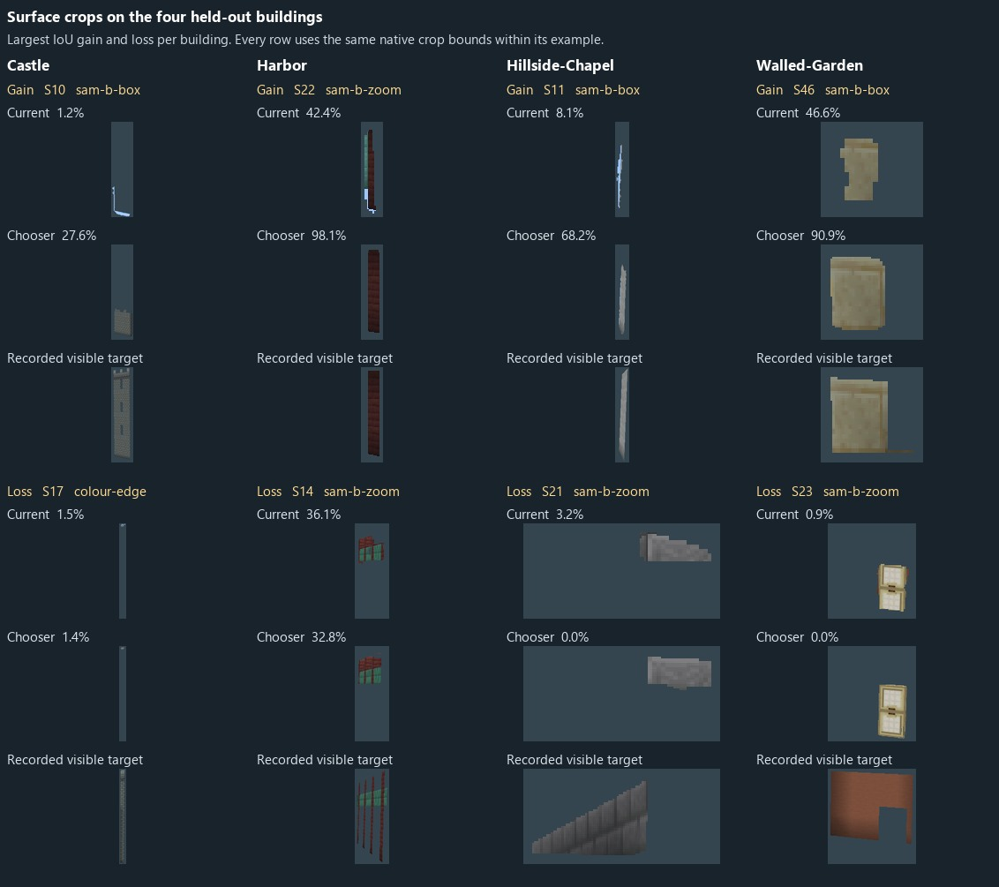

# Choosing the visible surface crop

**Keep `experiment/sky-crop-chooser` experimental.** On all four buildings held out from fitting, the chooser improved native surface-mask IoU. The options still missed most connected full-cube surfaces, and tightening one crop can erase the only pixels offered for an adjacent surface. Only the benchmark, its fitted coefficients, chosen native supports and score receipts landed on this branch.

## Six paired open-sky pictures

The reference scorer matches each of the 193 active Surface Finder proposals to its highest-IoU connected coplanar full-cube target in the native 1440×900 frontmost face-ID map. That identity stays fixed across alternatives. Non-full-cube decorative faces are outside this target definition. Multiple crops can have the same target. Mean crop IoU weights proposals equally. The surface count independently credits each reference target once if any output crop reaches 50% IoU.

| Building | Crops | Mean crop IoU, current / chosen / oracle | Distinct surfaces at 50% IoU, current / chosen / oracle | Crops improved / tied / regressed with chooser |
|---|---:|---:|---:|---:|
| Pillars, development | 31 | 53.58 / 63.06 / 66.87% | 19 / 20 / 20 | 28 / 1 / 2 |
| Viaduct, development | 33 | 51.16 / 58.97 / 68.70% | 18 / 19 / 23 | 26 / 4 / 3 |
| Harbor, validation | 34 | 45.42 / 54.74 / 63.24% | 15 / 18 / 23 | 31 / 1 / 2 |
| Hillside Chapel, validation | 27 | 24.15 / 37.46 / 42.85% | 7 / 9 / 10 | 18 / 3 / 6 |
| Castle, test | 17 | 46.61 / 50.95 / 57.44% | 9 / 9 / 10 | 13 / 2 / 2 |
| Walled Garden, test | 51 | 44.24 / 49.97 / 54.54% | 24 / 27 / 30 | 35 / 11 / 5 |
| **All six** | **193** | **44.53 / 52.79 / 59.09%** | **92 / 102 / 116 of 393** | **151 / 22 / 20** |

On the 129 held-out crops the current, chosen and oracle scores were 40.66%, 48.74% and 54.77%. Pooled across all six, the independently measured pixel-weighted IoUs were 32.69%, 35.08% and 39.92%. The strongest single policy for mean crop IoU, native colour-edge refinement after sky trimming, scored 47.39% across the six pictures.

The chooser removed 61,944 unique background pixels, with 6,189 remaining. Coverage of unique visible full-cube pixels rose from 94.93% to 95.27%, although the number of surfaces with zero covered pixels rose from 10 to 16. The oracle optimizes each proposal's paired IoU independently. It selected smaller masks that reduced union coverage to 71.10%, leaving 101 surfaces untouched. Among all options before selection, every target had some overlapping pixels, but only 122 of 393 had a candidate at 50% IoU. Recovering the remaining 271 at that threshold requires new proposals or different masks.



## Decision rule and reproduction

The rule compares keeping the live crop with ten replacement supports. Five candidates come from source evidence: trim residual border-sky colours, align a two-pixel collar to observed RGB edges after trimming, fit local normal and relative inverse depth in a six-pixel collar, retain the largest connected trimmed piece, or use a frozen Pixel-wise Planarity region. The other five are prompted MobileSAM box and points, SAM ViT-B box and points, and SAM ViT-B on a zoomed crop.

The ridge regressor predicts change in crop IoU using relative mask shape, sky coverage, normal consistency, inverse-depth residual, border evidence, agreement with other proposals and candidate identity. A held-out-development-building check selected the penalty (32) and minimum predicted gain (0.02) before fitting both development buildings together. The frozen chooser changed 176 masks and kept 17. Test and validation building labels enter only the separate scorer. The oracle can pick the current mask and breaks ties in its favor.

The input handoffs are from floating branch revision `52de2c9`. Use the same pinned sky, model and reference checkouts for replay. The independent scorer lives on `experiment/sky-crop-reference`; the SAM options live on `experiment/sky-crop-models`. From the chooser checkout, run `python -m benchmark.sky_crop_options` and `python -m benchmark.sky_crop_chooser features`. In the reference checkout, run `python -m benchmark.sky_crop_reference --scores-only --output <chooser-run>/scores-all --candidates NAME=PATH ...` for the ten options in `benchmark.sky_crop_chooser.paths`. In the chooser checkout run:

```powershell
python -m benchmark.sky_crop_chooser train --scores runs/sky-crop-chooser/scores-all/report.json
python -m benchmark.sky_crop_chooser infer
python -m benchmark.sky_crop_chooser oracle --scores runs/sky-crop-chooser/scores-all/report.json
```

Score `learned.json` and `oracle.json` with the same reference CLI into `<chooser-run>/decisions`, then run `python -m benchmark.sky_crop_decisions_report` and `python -m benchmark.sky_crop_choice_sheet`. The archived packets are gzip-compressed sparse JSON. Omitted IDs retain their original native supports. [Inputs and field hashes](sources.json) · [Fitted weights and development trials](frozen.json) · [Scores, target identities, selections and regressions for every crop](scores.json) · [Chosen supports](learned.json.gz) · [IoU-oracle supports](oracle.json.gz)

## Placement scope

This branch scored the crop handoff only. Its placement and position-plus-ID effects require the separately replayed downstream consumer. The six sky pictures comprise four Visible Builds v3 views and two Decorative Builds v1 views. Historical production placement scores carried forward from revision `e3bd220` are below. [Published cohort scores](../camera-native-round-01/README.md)

| Cohort | Placement runs here / available | Prior strict / facade placement F1 | Prior strict / facade position + ID F1 |
|---|---:|---:|---:|
| Fixed trend | 0 / 104 | 91.27 / 93.42% | 84.68 / 88.51% |
| Visible Builds v3 | 0 / 144 | 46.63 / 48.04% | 28.04 / 29.08% |
| Decorative Builds v1 | 0 / 40 | 63.46 / 65.23% | 50.51 / 52.56% |
