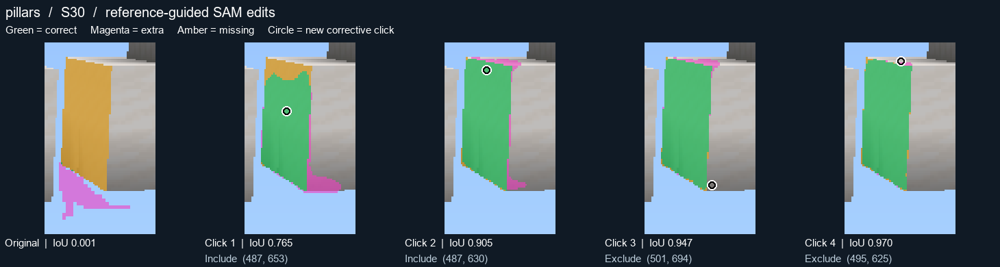

# Reference-guided crop corrections

Starting with the original mask, inspect its missing and extra regions against its fixed visible reference target. Place one positive click inside a missing region or one negative click inside an extra region, whichever has the deepest untried interior. Prompt SAM ViT-B again with the original box and all clicks so far. Compare the three returned masks against the same target and retain the highest IoU only if it improves on the previous mask. Record rejected attempts and continue exploring.

This is a teacher diagnostic. Reference labels determine the click, rank decoder candidates and decide acceptance. Native full-cube targets remain fixed from the independently checked baseline handoff. All five surfaces without a reference association keep their starting mask. The teacher does not create proposals for missed surfaces.

| Corrective clicks allowed | Mean IoU on 188 paired proposals |
| --- | ---: |
| 0 | 45.72% |
| 1 | 63.16% |
| 2 | 70.48% |
| 3 | 73.63% |
| 5 | 77.61% |
| 10 | 79.94% |
| 15 | 80.27% |
| 20 | 80.29% |

Of 1,459 attempted edits, 563 improved their current mask. 155 of 188 paired masks improved. 31 finished at or above .95 IoU, 154 stopped after five consecutive rejected clicks, and three reached the click limit. A plateau is specific to this prompt policy. The clicks marked 819 missing target regions, 400 neighboring faces with different directions, 124 parallel neighbors at another plane offset, seven disconnected coplanar neighbors, 77 non-full-cube regions and 32 background regions.

Pillars S30 had 0.00094 IoU with target T0085. Two positive clicks on the omitted face raised IoU to 0.765 and 0.905. Two negative clicks on adjacent faces with different directions raised IoU to 0.947 and 0.970. The displayed development example has the largest improvement among crops with at least three accepted edits. The full trace also includes stalled and unchanged crops.

## Replay

Run the commands in this checkout using the CUDA Python environment. The scorer module and native target rasterizer reside in the sibling sky-crop-reference checkout. The generator verifies the exact model checksum, implementation revision, RGB image and capture labels. No model weights are updated.

~~~powershell
../mask-scalelsd/runs/env/Scripts/python.exe -W ignore -m benchmark.sky_crop_corrections
../mask-scalelsd/runs/env/Scripts/python.exe -W ignore -m benchmark.sky_crop_click_example
~~~

The run writes independently replayable native-mask packets for rounds 00 through 20. This review archives the initial, one-click and final packets, the complete per-click trace, and the aggregate IoU by round. The SHA256 of the decompressed final.json is 19b69844c77765bf05c4121cbd244be72d7dcb138bc696f8f45096c4b8204c7a. Keep this branch experimental because inference on a new screenshot cannot access the teacher's reference target.
