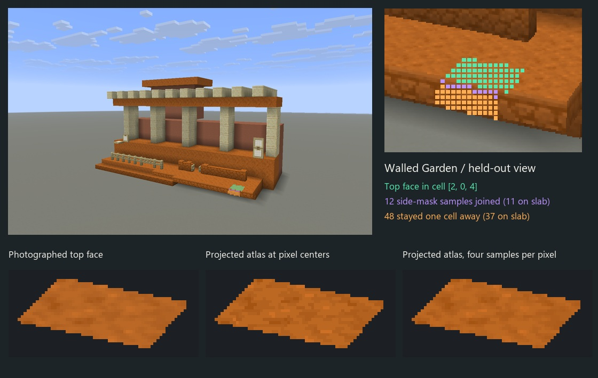

# A camera-conditioned atlas for visible block grids

**Keep `experiment/view-atlas-full-block-grid` experimental.** Rendering a candidate sprite at the photographed angle and distance helped attach portions of two slab sides to their correct top faces. Both occurred in the same held-out Walled Garden image. The integrated method lowered strict placement F1 relative to the ordinary build on the fixed and decorative cohorts. On v3 it raised strict placement by 0.18 percentage points and strict position-plus-ID by 0.07 points. This branch contains experiments and evidence. No ordinary build settings changed.



The top and side of each red sandstone slab projected to the correct registered world coordinate. The ordinary pack already contained both coordinates and exported `smooth_red_sandstone` there. All tested integrated packs retained that full-cube ID. For the slab at [6163, 65, 4], the new method moved a 12-sample side fragment from Z = 3.625 to Z = 4.0. Eleven samples belonged to the photographed slab. Another 37 true side samples remained in a neighboring cell. The pictured top tile’s RGB mean absolute error was 2.92 on a 0–255 scale for a point sample and 2.41 with four subpixel samples at the same fitted brightness. [Subface identities and recovered positions](partial-joins.json) · [Rendering inputs and errors](slab-render.json) · [Integrated Walled Garden datapack](walled-garden-joint.zip)

## What ran

The frozen Java 26.3 comparison uses exactly 104 fixed, 144 Visible Builds v3, and 40 Decorative Builds v1 screenshots. The ordinary build is revision `1ca8822`. The original grid is the source-only experiment at `1c6af5c`. The shared finite-footprint sampler and final Material Matcher policy come from `70bd4c7` and `83a8589`. Source estimates supply camera position, projected axes, viewpoint and visible regions. Recorded poses, frontmost pixel identifiers and partial-model labels are available only to the graders. The implementation was exercised on two development Market Court images before scoring all buildings with the same rules. These established cohorts have been reviewed in previous experiments.

- **C, ordinary.** Decode the released pack and verify its baseline geometry and materials.
- **A, atlas only.** The shared standalone experiment reranks IDs at ordinary coordinates. Its nine source samples per native pixel integrate grazing or distant texture footprints. The position set stays fixed.
- **G, grid only.** The frozen original grid verifies complete sprites on 16×16 rectified face crops, forms consensus over full-tile positions, and estimates neighboring partial-fragment levels from surface-mask contacts.
- **A+G, combined.** Generate the same coarse whole-sprite proposals, then score them in native source pixels. Use four subpixel texture samples and require independent pixel groups to agree. On an abstaining floor camera, test ±4% optical range and ±1/16-block UV shifts around the proposed full face. Verified anchors feed consensus and the shared grid. On an observed neighboring fragment, compare the prior plane with integer, half-block and ±1/4-block alternatives. Change an owner only for a verified score improvement with at least 85% of its sample rays favoring the same cell. Finally, apply the exact standalone nine-sample Material Matcher to the resulting ID map. The original Surface Finder masks and their openings are the input throughout. No mask boundaries were expanded or scored as improved.

The comparison also exports the old grid with the same final ID policy, the new grid before reranking, and a final one-point comparator on each grid. A separate upstream control runs all 288 inputs with the **identical new upstream search** and one sample at each native pixel center. The two sampling controls apply at different handoffs. No exact decorative-state prediction or unseen-cell completion is part of this experiment.

## Pooled scores on decoded exports

All values are percentages after the ordinary geometry-selected integer translation. Position-plus-ID requires the correct registry ID at that position, using the same shift. [Full scorecard including splits and camera-registered scores](summary.json) · [Paired cases with pack hashes](cases.json.gz) · [Inputs, atlas and implementations](manifest.json)

| Cohort | Method | Strict position | Facade position | Strict position + ID | Facade position + ID |
|---|---|---:|---:|---:|---:|
| Fixed 104/104 | C | 91.27 | 93.42 | 84.68 | 88.51 |
| | A | 91.27 | 93.42 | 82.01 | 87.31 |
| | G | 83.51 | 84.59 | 77.40 | 80.07 |
| | A+G | 84.10 | 85.25 | 77.05 | 79.99 |
| Visible v3 144/144 | C | 8.08 | 8.51 | 6.16 | 6.50 |
| | A | 8.08 | 8.51 | 6.21 | 6.56 |
| | G | 8.28 | 8.70 | 6.15 | 6.49 |
| | A+G | 8.26 | 8.69 | 6.23 | 6.58 |
| Decorative 40/40 | C | 54.33 | 56.11 | 43.43 | 45.34 |
| | A | 54.33 | 56.11 | 41.51 | 43.38 |
| | G | 53.94 | 55.57 | 41.67 | 43.42 |
| | A+G | 53.90 | 55.54 | 39.83 | 41.51 |

| Combined versus G | Combined correct / missed / extra | Positions recovered / lost | Extras added / removed | Exact IDs recovered / lost |
|---|---|---|---|---|
| Fixed | 20,826 / 2,876 / 5,001 | 0 / 0 | 4 / 351 | 179 / 401 |
| Visible v3 | 9,577 / 204,573 / 8,152 | 174 / 203 | 63 / 100 | 281 / 192 |
| Decorative | 7,289 / 9,637 / 2,829 | 41 / 39 | 63 / 40 | 75 / 319 |

Compared with C, A+G gained 53 and lost zero relative positions on fixed, adding 3,955 extras. It gained 278 and lost zero on v3, adding 1,293 extras. It gained 280 and lost 111 on decorative, adding 759 extras and removing 92. Partial-position recall was 430 / 1,630 for C, 458 for G and 461 for A+G. All three had zero exact partial-block IDs. On held-out decorative test views, strict geometry improved from 56.54% for G to 56.69% for A+G, while strict position-plus-ID fell from 39.34% to 34.73%.

The combined camera-registered strict placement and joint F1 were 84.10% / 77.05% on fixed, 6.61% / 5.63% on v3 and 53.67% / 40.36% on decorative. G registered 83.51% / 77.40%, 6.61% / 5.52% and 53.56% / 42.17%, respectively. The keep-or-select reference chooser reached facade placement F1 of 93.42%, 8.79% and 56.33% using the three actual C, G and integrated exports with C retained on ties.

## Which stage changed the answer?

| Strict position-plus-ID | Original G | Original G with common final view matcher | New grid before final matcher | New grid with point final matcher | New grid with view final matcher |
|---|---:|---:|---:|---:|---:|
| Fixed | 77.40 | 76.52 | 77.95 | 77.30 | 77.05 |
| Visible v3 | 6.15 | 6.21 | 6.16 | 6.23 | 6.23 |
| Decorative | 41.67 | 39.87 | 41.61 | 40.07 | 39.83 |

The final matcher recognizes only IDs in the ordinary opaque full-cube catalog. The last three columns use identical coordinates. The broader fixed geometry improvement comes mainly from introducing the native comparison and alternative depth proposals. On the **same upstream hypotheses**, replacing point samples with finite pixels changed strict position F1 by +0.043 points fixed, +0.023 points v3 and −0.065 points decorative. On v3 it accepted 33 floor-rejected exports instead of 29 with the matched point control and 31 with G. On decorative all three accepted four. Applying the integrated method only after the ordinary floor camera rejects an image gives strict position/joint scores of 91.27% / 84.68%, 8.28% / 6.19% and 54.47% / 43.45%. [Matched upstream control](upstream-point-control.json)

A native anchor passed the independent full-unit audit when at least 80% of footprint samples belonged to one actual full-cube face and mean corner error was within 0.20 projected blocks. G → A+G full-unit counts were 6,772 → 6,748 fixed, 1,675 → 1,673 v3 and 1,048 → 1,024 decorative. On floor-rejected v3 shots, these fell from 108 to 84. On rejected decorative shots they fell from 20 to 17. Median corner error on dominant full faces in these rejected sets changed from 0.037 to 0.040 and from 0.086 to 0.103 blocks. Correct signed directions on those faces changed from 115/115 to 96/97 and 22/22 to 21/21. None of these fallback anchors landed on its own photographed owner under the primary translated score. A plausible sparse repeat can align elsewhere on the structure. The measured camera support increase does not establish better overall camera recovery. [Direction, scale, ownership and corner audits](anchors-and-grouping.json)

## Partial subfaces and the counter

The geometric grouping audit uses the native first-visible face and block identities after source inference. On decorative views, G offered 2,468 visible fragments and grouped them into 2,443 cells. The integrated search offered 2,425 and grouped them into 2,383 cells. The number of partial target blocks supporting at least one majority fragment grew from 128 to 149. True partial blocks represented by multiple correctly joined photographed faces rose from zero to two, while incorrect joins of different true blocks rose from six to seven. Duplicate groups on represented partial targets rose from 90 to 101. Whole-cohort pure multiface groups, including full blocks, rose from seven to 21.

Both partial joins occurred on the same building and image, among 352 held-out partial targets and 1,630 overall. In Walled Garden, native-center sampling joined top and side fragments at [6163, 65, 4]. Finite pixel sampling also joined the two at [6158, 65, 4]. The second case used 35 true top samples out of 44 and 12 true side samples out of 14. Both recovered the exact cell before any global translation. Additional side pixels remained split on the first slab, and neither exact slab ID entered the export. These results support further work on projected subface matching, but the present rule is too narrow to promote.

## Reproduce

The registered sibling worktrees contain the immutable expanded controls, previous grid run and standalone view-atlas run. On this Windows workspace use the existing CPU OpenCV environment and calibrated Java 26.3 atlas. Running the following commands creates private per-image results under `runs/view-atlas-lattice-01` and `runs/view-atlas-lattice-point-01`. Material, audit and matched-sampling comparisons consume the completed upstream outputs.

```powershell
$py = '../mask-scalelsd/runs/env/Scripts/python.exe'
& $py -m benchmark.view_atlas_lattice_run --workers 2
& $py -m benchmark.view_atlas_lattice_final --workers 2
& $py -m benchmark.view_atlas_lattice_audit
& $py -m benchmark.view_atlas_lattice_point
& $py -m benchmark.view_atlas_lattice_partial
& $py -m benchmark.view_atlas_lattice_sheet
& $py -m benchmark.view_atlas_lattice_run --summary
```
