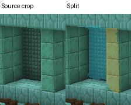
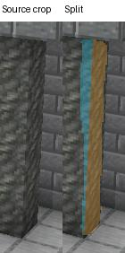

# Visible boundaries and signed face directions

Keep `experiment/visible-boundary-direction` experimental. A split recovered two parallel photographed planes in Stable Yard and improved its exported facade placement F1 by 3.02 percentage points. Both Decorative Builds improvements came from training views. On the 18 Visible Builds validation views, the image-only rule reduced pooled facade placement F1 from 19.9455% to 19.8872%.

Compared with ordinary Java 26.3 at `1ca88221bf2a29d4495b61a783b0c99273ee0634`, all three cohorts used their full visible-target denominator. Camera failures account for 108/144 Visible Builds and 10/40 Decorative Builds. All 104 fixed cameras are supported.

| Dataset and arm | Strict placement F1 | Facade placement F1 | Strict position + ID F1 | Facade position + ID F1 | ID accuracy on correct positions |
| --- | ---: | ---: | ---: | ---: | ---: |
| Fixed 104 control | 91.2678% | 93.4194% | 84.6818% | 88.5099% | 92.7839% |
| Fixed 104 source | 91.2682% | 93.4198% | 84.6825% | 88.5104% | 92.7842% |
| Fixed 104 perfect image chooser | 91.2705% | 93.4224% | 84.6850% | 88.5132% | 92.7846% |
| Visible Builds v3 control (144) | 8.0753% | 8.5068% | 6.1561% | 6.5006% | 76.2340% |
| Visible Builds v3 source | 8.0835% | 8.5111% | 6.1640% | 6.5073% | 76.2544% |
| Visible Builds v3 perfect image chooser | 8.0870% | 8.5149% | 6.1630% | 6.5044% | 76.2084% |
| Decorative Builds v1 control (40) | 54.3346% | 56.1097% | 43.4295% | 45.3351% | 79.9298% |
| Decorative Builds v1 source | 54.4351% | 56.2355% | 43.4809% | 45.4096% | 79.8766% |
| Decorative Builds v1 perfect image chooser | 54.4934% | 56.2974% | 43.5566% | 45.4902% | 79.9300% |

The source rule changed 2, 6 and 2 decoded block maps respectively. After the ordinary whole-build translation, its changes to strict correct positions and extras were:

| Cohort | Correct gained | Correct lost | Extras added | Extras removed |
| --- | ---: | ---: | ---: | ---: |
| Fixed 104 | 1 | 0 | 2 | 1 |
| Visible Builds v3 | 29 | 21 | 303 | 347 |
| Decorative Builds v1 | 21 | 10 | 4 | 23 |

Fixed strict placement went from 20,773 correct, 2,929 missed and 1,046 extra to 20,774 correct, 2,928 missed and 1,047 extra. The source facade result had 18,953 correct, 1,623 missed and 1,047 extra.

## The photographed decision

For a vertical wall patch, find a sustained, same-signed RGB contrast along an upright line from the estimated camera. Sample image gradients inside the two new masks and compare tangent directions against both projected horizontal world axes. The **crease** proposes two masks when their preferred tangents differ. The changed face receives the orthogonal camera-space normal directed toward the viewer. The **parallel split** requires two votes for the original wall axis and a consistent discontinuity in the ends of support on opposite sides of the seam. This is a silhouette or opening cue. It supplies no metric depth.

Each split partitions the exact native pixel-center mask. Assertions verify identical union and disjoint children. Each child gets a sampling chart refit on its own pixels, which bundles a chart change into the split. Original support, quad and source crop stay intact in the direction-only arm. Later stages can independently reassign or reject the proposed planes. The placer estimates level and sign from camera-facing geometry. The normal vote primarily changes its choice of axis.

The source rule uses the highest-ranked crease in an image, or the highest-ranked parallel split when there is no crease. Each kind independently offers at most one intervention per image. A stricter confidence setting requires both tangent vote margins of at least 0.10 and seam strength of at least 12. It abstained on all creases. All thresholds and the image-only decision were fixed before grading their candidates. The six crease and nine parallel proposals touched 12 unique views. Only the grader loads the recorded faces, layout transform and visible block IDs.

| Whole-image arm, facade F1 (%) | Fixed 104 | Visible Builds v3 | Decorative Builds v1 |
| --- | ---: | ---: | ---: |
| Keep | 93.4194 | 8.5068 | 56.1097 |
| Crease, split only | 93.4194 | 8.5051 | 56.2041 |
| Crease, direction only on original host | 93.4201 | 8.4924 | 56.0983 |
| Crease, split and change one child's direction | 93.4198 | 8.5030 | 56.1421 |
| Parallel, split only | 93.4194 | 8.5150 | 56.2740 |
| Stricter source confidence | 93.4194 | 8.5149 | 56.2740 |
| Best offered arm per image | 93.4224 | 8.5149 | 56.2974 |
| Exact best pooled F1 within these options | 93.4224 | 8.5159 | 56.2974 |

The perfect image chooser maximizes each view's facade placement F1, keeping the ordinary output on a tie. The pooled chooser maximizes the cohort ratio directly. The latter accounts for differences in denominator between images. At most 0.0030, 0.0091 and 0.1878 percentage points of pooled facade F1 are recoverable from these proposals. The small number of independent proposed buildings, the drop on Visible Builds validation, and the absence of decorative holdout proposals leave too little evidence to fit a transferable learned chooser.

## Development and held-out results

| Cohort / split | Views | With proposals | Ordinary facade F1 | Source facade F1 | Best offered per image |
| --- | ---: | ---: | ---: | ---: | ---: |
| Fixed historical regression | 48 | 3 | 92.4266% | 92.4275% | 92.4336% |
| Fixed fresh / native / old | 8 / 12 / 12 | 0 | 91.1664% / 95.3250% / 89.9440% | same | same |
| Fixed validation / test | 12 / 12 | 0 | 94.8795% / 96.1680% | same | same |
| Visible Builds train | 108 | 4 | 10.3013% | 10.3125% | 10.3125% |
| Visible Builds validation | 18 | 3 | 19.9455% | 19.8872% | 19.9610% |
| Visible Builds test | 18 | 0 | 0.0000% | 0.0000% | 0.0000% |
| Decorative Builds train | 24 | 2 | 57.4249% | 57.6367% | 57.7403% |
| Decorative Builds validation | 8 | 0 | 47.5673% | 47.5673% | 47.5673% |
| Decorative Builds test | 8 | 0 | 59.0989% | 59.0989% | 59.0989% |

## What changed at the surface

Stable Yard's two native signed-Z surfaces lie two blocks apart. Of 4,968 supported pixels, zero are background. Splitting increases the sum of each child's majority reference-surface pixels from 2,626 to 4,686. The split gains 12 correct positions, loses four, removes 11 extras and adds one. For five other parallel proposals, each child's dominant plane is coplanar with its sibling. For three, the dominant planes are perpendicular. The silhouette and texture vote alone does not distinguish these situations reliably.



In the two Shopfront regressions the crease plus direction change adds 1,439 and 1,523 correctly oriented pixels. The first view loses 0.21 facade points and the second gains 0.35. In Viaduct the same intervention adds 1,672 correctly oriented pixels and improves facade F1 from 81.49% to 82.78%. In Market Court it loses 1,806 correctly oriented pixels. In the two held-out Harbor views, the combined change loses 532 and gains 495 correctly oriented pixels, and lowers facade placement F1 on both.



## Replay and evidence

Run from the experiment worktree with the primary Python runtime, the installed Java 26.3 atlas, the registered fixed-suite fixtures and the expanded control handoffs under `../full-expanded-controls/runs/expanded-baseline-01`.

```powershell
python -m benchmark.visible_boundary_capture
python -m benchmark.visible_boundary_screen
python -m benchmark.visible_boundary_evaluate corner
python -m benchmark.visible_boundary_evaluate parallel
python -m benchmark.visible_boundary_control
python -m benchmark.visible_boundary_report
```

The revised supports enter the first pre-inset detector call and its saved context alias. Counting, ordinary placement checks and material export run for each offered arm. Every changed expanded run returned the original camera projection. Controls on unaffected views reuse the verified decoded production exports. Nine unchanged-input expanded replays cover all expanded images with proposals. The previous fixed replay reproduced all 104 released packs byte for byte. Datapack ZIP metadata can vary on expanded replays, so decoded comparisons hash sorted integer coordinates and block IDs.

The [pooled and split results](summary.json) include exact counts, camera-supported cohorts, all ablations, ID scores and both reference choosers. The [per-image results](cases.json.gz) include source and reference fingerprints, measured stage effects, pack hashes, per-option deltas, and source-only choices. [Crops for all proposed interpretations](previews/) show the source next to its exact partition. The ordinary reconstruction default remains at the measured production revision for this experiment.
