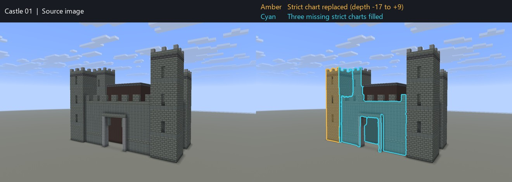

# Wall ruler depth ablation, November 27, 2026

**Keep `experiment/wall-ruler-depth-ablation` experimental.** Most of the gain came from resolving an existing depth disagreement on one Castle tower. Two independent one-block depth changes helped elsewhere, but only one was a transfer example. No runtime changes landed on `main`.

The atlas ruler compared each photographed wall against five possible depths. This replay separates confirming the wall ranker's existing integer depth from choosing another depth. Both options apply the existing native-single rule to its full source mask. The same downstream placement, opening checks, material assignment and datapack export run afterward. The ordinary single-image runtime is at `e3bd220`. The experiment branches from the original ruler report at `4942e2e`.

Of 23 accepted integer, unit-pitch, zero-phase fits, 21 confirmed the ranked depth. The other two moved a mask by one block, from 8 to 7 on development Market Court and from 9 to 8 on transfer Walled Garden. A depth confirmation can fill a missing strict chart or overwrite a chart whose depth disagrees with the ranker. Both decisions use only the original photographed evidence. Registration for final scoring uses one integer translation per exported build.

## Paired export results

| Selection | Position F1, strict / facade | Position + ID F1, strict / facade | Correct / missed / extra | Recovered / lost | Extras added / removed |
|---|---:|---:|---:|---:|---:|
| Ordinary | 54.24 / 57.48 | 35.14 / 37.87 | 6,246 / 7,768 / 2,771 | 0 / 0 | 0 / 0 |
| Confirm ranked depth | 54.86 / 58.15 | 35.84 / 38.62 | 6,351 / 7,663 / 2,790 | 106 / 1 | 21 / 2 |
| Accept new depth | 54.43 / 57.70 | 35.32 / 38.08 | 6,266 / 7,748 / 2,743 | 30 / 10 | 14 / 42 |
| Both | 55.05 / 58.37 | 36.01 / 38.83 | 6,371 / 7,643 / 2,762 | 136 / 11 | 35 / 44 |

The 21 confirmations account for 105 of the 125 net recovered positions, including 101 on Castle 01. The two new depths account for the remaining 20. On Market Court the changed depth recovered five positions, lost three, added five extras and removed ten. On Walled Garden it recovered 25, lost seven, added nine extras and removed 32. On each of those frames, the new-depth-only arm reproduces every aligned coordinate and ID from the whole arm. The ranked-only arm also retains the prior Viaduct regression of eight added extras.

Each entry below gives strict / facade F1 in percent. Pools use summed counts.

| Pilot coverage | Metric | Ordinary | Confirm ranked | Accept new | Both |
|---|---|---:|---:|---:|---:|
| Fixed 2 / 104 | Position | 87.02 / 92.52 | 87.02 / 92.52 | 87.02 / 92.52 | 87.02 / 92.52 |
| Fixed 2 / 104 | Position + ID | 85.46 / 90.70 | 85.46 / 90.70 | 85.46 / 90.70 | 85.46 / 90.70 |
| Visible Builds v3 9 / 144 | Position | 51.91 / 55.26 | 52.61 / 56.02 | 51.91 / 55.26 | 52.61 / 56.02 |
| Visible Builds v3 9 / 144 | Position + ID | 31.21 / 34.04 | 32.00 / 34.91 | 31.21 / 34.04 | 32.00 / 34.91 |
| Decorative Builds v1 2 / 40 | Position | 64.82 / 65.53 | 64.82 / 65.53 | 68.14 / 69.16 | 68.14 / 69.16 |
| Decorative Builds v1 2 / 40 | Position + ID | 56.79 / 56.99 | 56.79 / 56.99 | 59.91 / 60.42 | 59.91 / 60.42 |
| Development 5 / 5 | Position | 64.36 / 65.10 | 64.36 / 65.10 | 64.44 / 65.21 | 64.43 / 65.21 |
| Development 5 / 5 | Position + ID | 41.18 / 41.60 | 41.11 / 41.53 | 41.22 / 41.69 | 41.15 / 41.61 |
| Transfer 8 / 8 | Position | 48.92 / 53.02 | 49.89 / 54.10 | 49.17 / 53.30 | 50.14 / 54.39 |
| Transfer 8 / 8 | Position + ID | 31.97 / 35.69 | 33.08 / 36.93 | 32.22 / 35.96 | 33.33 / 37.21 |

## Castle 01

On the left tower, the ordinary ranker selected depth +9 along Z while the strict placement chart supplied −17. Applying the confirmed +9 to this one wall reproduced the full ruler's decoded coordinates and IDs. Correct positions rose from 1,033 to 1,134 and exact IDs rose from 583 to 685. The other three masks had missing strict charts. Applying only those three confirmations recovered 18 positions and lost ten, while correct IDs fell to 573. Their isolated gains do not add to the four-mask output.



## Reproduction and coverage

From this checkout use the workspace Python environment with OpenCV, NumPy and Pillow.

```powershell
../mask-scalelsd/runs/env/Scripts/python.exe -m benchmark.wall_ruler_depth_ablation --workers 3
../mask-scalelsd/runs/env/Scripts/python.exe -m benchmark.wall_ruler_depth_overlay
```

The runner checks the original source image hashes, original ruler record and export file fingerprints, and the ordered union of selected carriers for every frame. For matching signatures it reads the released ordinary pack or the original native-single receipt and checks the actual pack hash. Six fresh replays cover the two mixed frames and the two Castle chart subsets. The frozen zero-control replays are decoded and compared with released inventories for all ten available frames. Truth is used only after prediction to score recovered and lost sites and extras added and removed. [Per-frame signatures, pack hashes, receipts and paired scores](results.json) · [Original finite option set and design](../local-wall-rulers-01/README.md)

The complete cohorts retain their previously measured ordinary results. The 104 fixed views have 20,773 correct, 2,929 missed and 1,046 extra strict positions, with strict / facade placement F1 of 91.27 / 93.42 and position + ID of 84.68 / 88.51. The 144 Visible Builds v3 views have 46.63 / 48.04 placement and 28.04 / 29.08 position + ID. The 40 Decorative Builds v1 views have 63.46 / 65.23 placement and 50.51 / 52.56 position + ID. Full-cohort deltas remain unmeasured.
