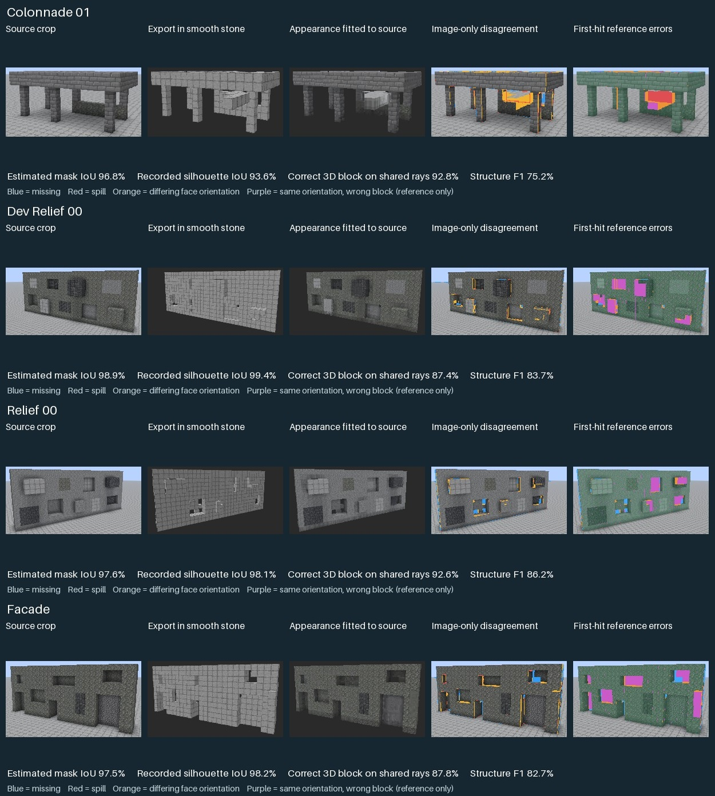

# Reprojecting wall placements into their source screenshot

The estimated camera and exported cells can explain why placement looks wrong, even when the silhouette is close. On Colonnade 01, the exported projection covers most of the shape but spills into the openings. The detector itself marked much of this spill as structure. A separate floor-texture comparison identifies three false blocks in the pictured right view. The same rule also erases a real flush pavement platform in a controlled test, so it stays experimental.

The second column renders the actual exported smooth-stone blocks using approximate directional lighting. The third fits separate vanilla texture appearances to the source on alternate image patches. It shows how well the geometry can explain the photograph with a plausible texture. In the fourth column, blue marks estimated surface pixels missing from the projection, red marks spill beyond the estimated masks, and orange marks a differing face axis. The fifth column checks the projection against recorded first-hit faces. Purple identifies the correct face axis at the wrong 3D block. Each panel uses one source pixel every two pixels along each axis. The cameras were estimated from the image. Recorded camera and visible labels enter only the evaluation column and metrics.

| Build | Relative block F1 | Estimated surface mask IoU | Recorded silhouette IoU | Right first-hit face axis on shared rays | Right first-hit block on shared rays | Rays to missed blocks that another placement covers |
| --- | ---: | ---: | ---: | ---: | ---: | ---: |
| Colonnade 01 right | 75.22% | 96.75% | 93.59% | 95.15% | 92.83% | 87.95% |
| Dev Relief 00 | 83.70% | 98.88% | 99.45% | 98.47% | 87.39% | 95.59% |
| Relief 00 | 86.21% | 97.59% | 98.09% | 98.76% | 92.57% | 77.18% |
| Facade | 82.69% | 97.54% | 98.17% | 98.46% | 87.84% | 80.60% |

Relative block F1 admits a single common XYZ translation. The pixel comparisons preserve the estimated camera and registered layout. A small return changes few image pixels despite identifying a distinct 3D cell. On Dev Relief, 6,913 of the 7,232 sampled rays to missing blocks already hit some other predicted block, including 6,223 hitting a face with the correct axis. Moving a candidate one block and testing against withheld texture patches identifies one correct replacement there. Selecting by that appearance score with a nonnegative change in geometric support also recovers one on Relief 00 and abstains on Facade and Colonnade. One Facade move improves the texture-only score but damages the geometric fit and identifies a wrong block.

The independent readback on all 104 fixed frames reproduced 20,510 visible positions correct, 1,157 extra, and 3,192 missed, or 90.4142% pooled F1. Across 4,654,192 shared rays, 4,591,861 had the correct face axis and 4,451,698 first hit the correct block. A further 145,574 had the correct axis on a different block.

## Paired candidate results

| Prespecified method | Fixed 104 | Alternate 20 | New loading dock 4 | New shelter and gate 4 |
| --- | ---: | ---: | ---: | ---: |
| Default at 028819a | 90.414% | 88.554% | 83.580% | 83.474% |
| One depth move supported by shape and held-out appearance | 90.432% | 88.579% | 83.580% | 83.353% |
| Also test adding and deleting each endpoint independently | 90.427% | 88.579% | 83.580% | 83.353% |
| Remove placements where visible texture matches the ground plane | 90.424% | 88.720% | 83.580% | 83.474% |

The first two methods improve the pooled fixed score and both lose a correct visible cell and place a hidden one on the high-right Offset Gate transfer. Keep both as decision-model features or diagnostic proposals. Per-picture one-move perfect choices, image-only choices, and source/truth separation are in [the named case review](move-review.json).

The floor comparison learns the repeating ground tile from background pixels elsewhere in the same picture, independently estimates it on two spatial halves, then compares candidate first-hit samples to that tile at the ground plane's predicted texture phase. Across 204 captures, including the 72 development frames, it removes 20 extras on three images covering two layouts and loses zero correct cells. The right Colonnade goes from 75.22% to 75.90%, the alternate left from 65.92% to 68.80%, and the native adjacency structure from 97.73% to 98.01%. The ground test took 0.72–0.77 seconds on three single-process calls on the right Colonnade with inputs loaded.

The controlled negatives use the same estimated Colonnade camera and color pattern. A synthetic elevated cube displaying the ground material in each of its own face coordinates is correctly retained. A 3×3 platform flush with surrounding pavement, explicitly supplied as a detected surface, loses all nine visible top blocks. Adding a gate that requires 16 samples on an individual projected vertical face still deletes two edge blocks of that platform. The partial reconstruction has open space next to its edge and the render exposes a side that the actual surrounding ground occludes. Among the 20 correct removals on real captures, this gate retains ten. A product default needs to preserve legitimate flush and elevated build floors. Treat the ground result as an annotation for inspecting openings pending independent evidence of a visible opening boundary. See [all first-hit counts and counterfactual outcomes](floor-controls.json).

## Reproduction and evidence

Run `python -m benchmark.wall_source_projection` from this checkout with the frozen production exports at `../facade-placement-round/runs/production`. Then run `python -m benchmark.wall_projection_move_review benchmark/reviews/wall-source-projection-01`. The resulting [104-camera projection audit](projection.json) identifies the source and build hashes. The four raw move tables contain each one-cell alternative evaluated on these examples.

Use `benchmark.wall_section_eval` from the wall-section-round evaluator at b17caa8 with candidate root pointing here. The adapters are `benchmark.wall_projection_trial:both`, `benchmark.wall_projection_trial:both_necessary` and `benchmark.wall_floor_counterfactual:recover`. Run each with and without the evaluator's `--transfer-inputs` argument to reproduce 200 primary/development/alternate plus four transfer predictions. `python -m benchmark.wall_floor_controls` reads the floor run at `runs/floor` and the matched control at `../wall-section-round/runs/control`. The [result manifest](results.json) hashes the [archive of scored cases and changed exports](comparisons.zip).
