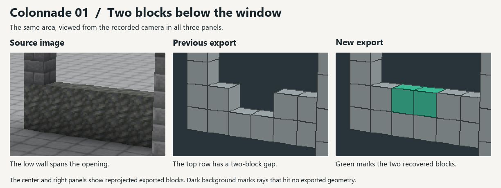

# Colonnade 01 window wall

The ordinary build now exports the two adjacent wall blocks below the right-hand opening. The source-image wall mask covered both front faces. Placement had already proposed both coordinates on the correct wall plane. A temporary row of elevated pavement cubes in the opening covered the two faces during the visibility vote. Cleanup removed those false cubes after the wall candidates had been discarded.

## Which change helped

| Variation | Colonnade 01 right | Other views | Decision |
| --- | --- | --- | --- |
| Exclude elevated pavement candidates before the first vote | Recovers the pair, gains seven correct positions in total, loses two correct roof positions and adds two extras | The left view loses one correct position and adds two net extras | Experimental |
| Give wall faces a separate vote while the pavement candidates remain | Both candidates win the vote, then the next occlusion check discards them | All 204 final placements tie the baseline | Experimental |
| Recheck wall faces after pavement cleanup | Recovers exactly the pair, with zero losses or new extras | All other 203 views retain their previous placements | Default |

The default uses the measured wall plane and the camera estimated from the source image. It reprojects missing wall candidates whose base and at least one side already have a placed neighbor in the wall. At least four samples and at least 75% of a candidate face must be visibly supported by the wall mask after cleanup and must have been obscured by the provisional pavement. Fewer than four samples may already have been visible in the comparison with that pavement present. On the target pair the faces recover all 51 and 52 samples. Base and neighboring blocks alone cannot authorize a placement. [Placement rule](../../../engine/window_wall_recheck.py) · [Previous mask and visibility trace](../shared-face-round-01/colonnade-01-window-wall.png)

## Placement scores

| Scope | Metric | Previous | New | Correct | Missed | Extra |
| --- | --- | ---: | ---: | ---: | ---: | ---: |
| Colonnade 01 right | Strict | 77.06% | 77.81% | 128 | 63 | 10 |
| Colonnade 01 right | Facade-priority | 92.63% | 93.75% | 90 | 2 | 10 |
| Fixed 104 | Strict | 91.0741% | 91.0788% | 20,730 | 2,972 | 1,089 |
| Fixed 104 | Facade-priority | 93.2022% | 93.2075% | 18,909 | 1,667 | 1,089 |

The fixed-suite camera-registered strict score is also 91.0788%. The historical 112-view strict score is 90.3170%. All 204 saved views went through the opening detector. Both Colonnade views triggered the recheck, and only the right-hand export changed. The 100 additional controls are included in the 204. The ordinary source-image command reproduced the scored block coordinates and materials on both Colonnade views, Loading Dock and Platform Shelter. The right-hand source produced byte-identical surface and count files before and after. [Per-view results](cases.json) · [Pooled scores](summary.json) · [Changed export](default-exports.zip) · [Ordinary build checks](ordinary.json)

## Replay

Run `python -m benchmark.window_wall_recheck_eval` with the frozen fixtures. Run `python -m benchmark.window_wall_sheet` to render the comparison from the saved exports and `python -m benchmark.current_placement_viewer` to refresh the stage overlays. The tested behavior is `c9ba974` on `main`. The two earlier votes remain on their experiment branches. [Broad early vote](https://github.com/jeremyepling/minecraft-image-reconstruction/tree/d02a53b/benchmark/reviews/opening-candidate-vote-01) · [Wall-only early vote](https://github.com/jeremyepling/minecraft-image-reconstruction/tree/0906be4/benchmark/reviews/window-wall-vote-only-01)
