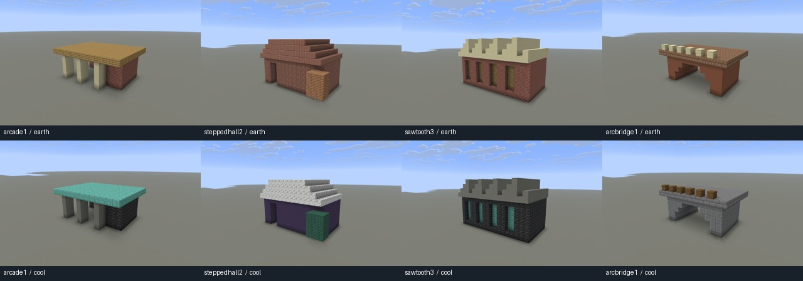

# Visible Builds v2

A reusable pilot for recovering the visible blocks of a Minecraft structure from one screenshot. The release contains 144 original Minecraft Java 26.3 framebuffer PNGs with per-view block labels. Each split downloads independently. [GitHub release](https://github.com/jeremyepling/minecraft-image-reconstruction/releases/tag/visible-builds-v2) · [Checksums and frame index](visible-builds-v2.json)

| Split | Layouts | Frames | Use |
| --- | ---: | ---: | --- |
| Train | 18 | 72 | Six new families, with three layouts in each |
| Validation | 3 | 12 | Cloisters, for choosing settings |
| Test | 3 | 12 | Twin spires, for evaluating a frozen method |
| Regression | 8 | 48 | Whole-structure views from the original exterior suite |



The new families in training are arcades, stepped halls, sawtooth roofs, terraces, watchposts and arched bridges. Each new layout appears with two material palettes at two camera positions. Eight wall/trim/accent combinations rotate across the layouts. Paired views let a researcher measure sensitivity to appearance while the geometry stays fixed. Each frame is its own single-image example. One held-out family per evaluation split gives a first transfer check. Broader accuracy claims will need additional families and player-authored builds.

## Whole-structure admission

Every image used for learning, including local counting and material decisions, comes from a frame that contains the complete build with background on all four sides. V2 requires a horizontal gap of at least 2% of image width on each side and a vertical gap of at least 2% of image height above and below. At 1440 by 900 this requires at least 29 empty pixel columns and 18 empty pixel rows. The packager projects all eight corners of each occupied source building block and separately measures the full-resolution visible silhouette. Floor probes are excluded. This catches an entirely off-screen component even when the visible portion fits. Only visible block faces supply learning targets.

We audited all 152 original entries. The eight removed views were the front close-ups of Wing and Courtyard on both palettes and floor settings. All eight were regression examples. Every training, validation and test image passed, and every surviving screenshot has at least 10% clearance on all four sides. The smallest margin is 93 pixels above the low-left Watchpost 1, in both palettes. An independent check of the 56 additional benchmark photos found no further failures. [Per-frame dataset audit](framing-audit-v2.json) and [additional evaluation views](../benchmark/reviews/whole-structure-framing-01/evaluation-only.json).

The v2 archives omit the eight rejected frame directories and their labels. The original release is an archive for replaying previously published scores. Use v2 for training and count evaluation.

## Get the files

From a checkout of the repository, download the v2 assets to a new directory. The four data ZIPs are self-contained. Extract each into its own split directory if working with uncompressed files.

```powershell
gh release download visible-builds-v2 --repo jeremyepling/minecraft-image-reconstruction --dir runs/visible-builds-v2
python -m training.verify_dataset --manifest runs/visible-builds-v2/manifest.json --source .
```

If the five original v1 ZIPs are already on disk, reproduce the v2 assets from them in a fresh output directory.

```powershell
python -m training.package_dataset --from-v1 runs/visible-builds-v1 --out runs/rebuilt-visible-builds-v2
```

Read a training example directly from its archive with Python, Pillow and NumPy.

```python
import io
import json
from zipfile import ZipFile

import numpy as np
from PIL import Image

with ZipFile("runs/visible-builds-v2/visible-builds-v2-train.zip") as archive:
    row = json.loads(archive.read("frames.jsonl").splitlines()[0])
    folder = row["directory"]
    rgb = np.asarray(Image.open(io.BytesIO(archive.read(f"{folder}/rgb.png"))).convert("RGB"))
    truth = json.loads(archive.read(f"{folder}/labels.json"))
    with np.load(io.BytesIO(archive.read(f"{folder}/labels.npz")), allow_pickle=False) as maps:
        visible_building = maps["face_id"] > 0
        depth_in_blocks = maps["depth_z"]
    placements = [(block["xyz_local"], block["state"]) for block in truth["blocks"]]
```

For image-only experiments pass the RGB and game version to the predictor. Open the target files when computing a training loss or scoring a prediction. World readbacks and camera files give a diagnostic access to privileged information. Keep that distinction when comparing methods.

## Coordinates and labels

| File per frame | Contents |
| --- | --- |
| `rgb.png` | Exact 1440 × 900 framebuffer PNG |
| `camera.json` | Native renderer eye position in world XYZ, yaw/pitch, vertical FOV, column-major JOML projection of camera-relative points, resolution, clock, weather, HUD, game version and packs |
| `labels.json` | Visible blocks and exact state strings, integer world and local coordinates, visible face table, metric calibration, projected face corners, per-corner visibility and connected coplanar surface IDs |
| `labels.npz` | Full-resolution `face_id` uint16 and `depth_z` float32 arrays, indexed by image row then column |
| `reference-faces.json` | Benchmark reference with role names, per-face visible pixel counts and fractions |
| `world-readback.json` | Exact server readback for the sampled site, including source block states and light probes. Full readback is labeling provenance |
| `frame.json` | Layout, split, palette, camera angle, origin, counts and file hashes |

World axes follow Minecraft XYZ, with Y up. The origin is the componentwise minimum occupied building coordinate, excluding floor probes. Subtract it from a world coordinate to get local XYZ. It is a reference coordinate system for the answer. A single photograph may leave the world origin and absolute heading ambiguous.

Pixel (column, row) is sampled at (column + 0.5, row + 0.5) from the image's top-left corner. Depth is distance along the camera's forward axis in blocks. Each positive face ID identifies the face table entry with that ID, which points to its visible block and surface. `corners_px` gives the full face footprint, and `corner_visible` indicates which corners have line of sight inside the frame. Some visible faces are partial. The material-independent surface IDs connect adjacent visible unit faces with the same outward normal and plane.

The labeler projects opaque full cubes and resolves the nearest face at each pixel center. A target block needs at least one supported pixel. A zero face ID with NaN depth means the ray has no labeled building hit. Floor and sky are background. A clear ray segment before a building hit supplies evidence of free space along that segment. Space behind the hit stays unknown. The dense maps record geometric visibility computed from the recorded camera and world, including a pixel-center approximation at silhouettes.

## Capture and versioning

The new renders use vanilla resources, a light gray concrete floor, noon at 6000 ticks, clear weather, hidden HUD and a 55° vertical field of view. Low-left and high-right cameras use azimuth offsets of −32° and +36° about each layout's center and eye heights of 3.1 and 10.1 blocks above the floor. Camera distance scales with building width and depth. The native measured pose in each frame is authoritative. The regression subset retains its original two floor conditions and camera placements. The capture-records ZIP preserves the new layout, exact generated blocks and roles, requested views, source index and selected saved client settings. Each split ZIP also carries the native readback and measured camera for every included frame.

Git tracks the capture recipes, label generator, verifier and release manifest. Exact PNGs and binary label maps are downloadable assets on the same repository's tagged GitHub Release. Reuse these assets for identical frames. A fresh live capture may differ because of renderer timing. Publish future additions as a new dataset version and retain these split assignments.

From the repository root, the pipeline for a fresh acquisition uses the installed Java 26.3 client, compatible JDK and the benchmark Python dependencies.

```powershell
python -m training.import_legacy --out runs/dataset-legacy
python -m training.capture_pilot --out runs/dataset-capture
python -m training.package_dataset --sources runs/dataset-legacy runs/dataset-capture --out runs/visible-builds-v2
```
